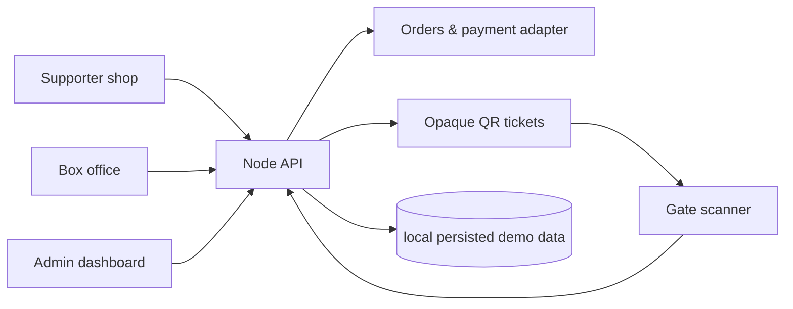

# Architecture

The prototype is a tenant-aware modular monolith. A small Node HTTP server serves the responsive web application and JSON API; `club_beltinci` scopes every event, type, order and ticket.

`DemoPaymentProvider` is represented by the payment callback endpoint: checkout creates `PENDING_PAYMENT`; only a successful callback marks it paid and idempotently issues tickets. QR payloads contain a cryptographically generated opaque credential, never customer data or an integer ID.

Redemption is performed inside the server's serialized persisted mutation. It conditionally checks ticket state, tenant and event, then creates an admission record. A subsequent request sees that admission and returns `already_used`. This only protects a single local Node process. PostgreSQL production deployment must replace this local store with a transaction and unique `(ticket_id, event_id)` admission constraint/conditional insert before any multi-process or live use.

## Consequential decisions

- **ADR-001 Modular monolith:** right-sized for a small club deployment and preserves one authoritative inventory/order/admission chain.
- **ADR-002 Tenant scope:** tenant/club ID is carried by domain records and protected resources are filtered against `club_beltinci`; a second seeded tenant exists for isolation testing groundwork.
- **ADR-003 Opaque QR credentials:** 24 random bytes encoded as base64url, persisted server-side.
- **ADR-004 Atomic redemption:** admission record is authoritative, not a global `used` boolean. The current JSON adapter is demo-only, not a database guarantee.
- **ADR-005 Payment adapter:** payment confirmation is an idempotent callback boundary; ticket issuance is not browser-controlled.
